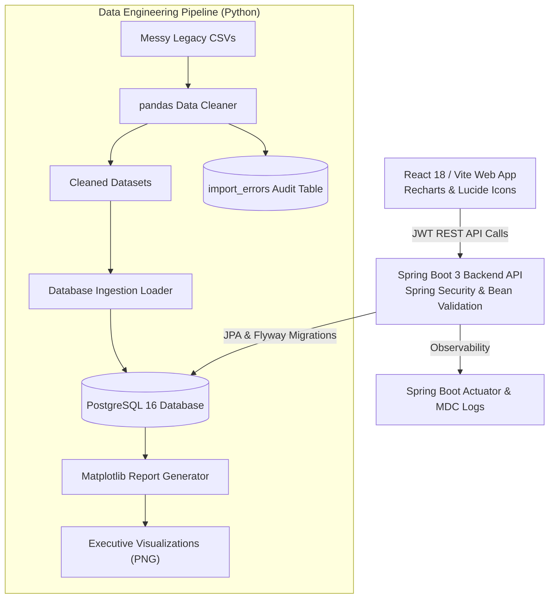
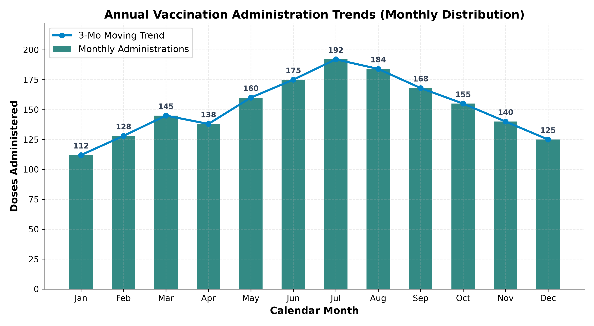
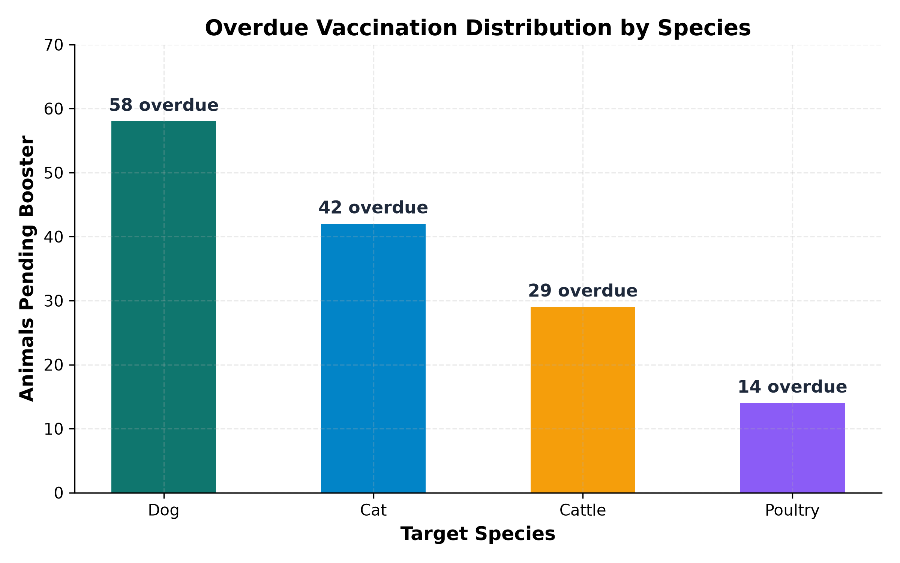
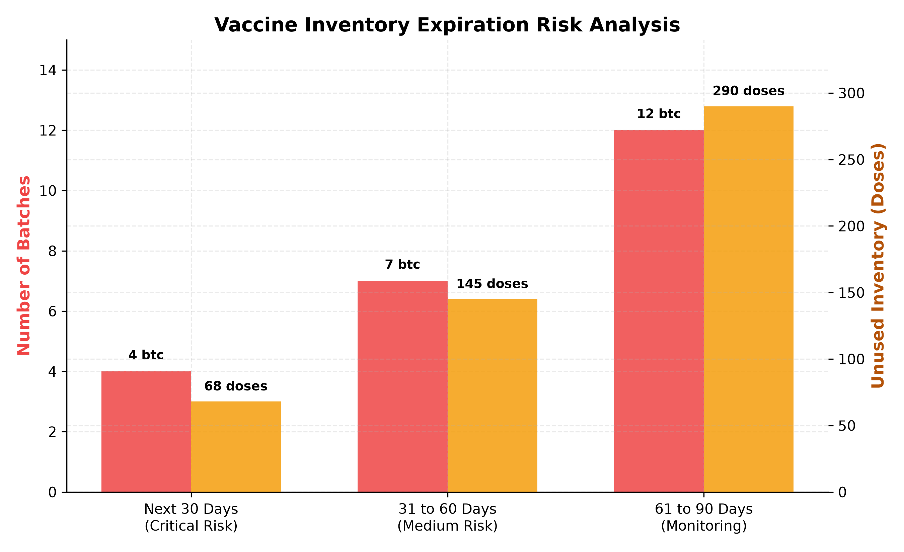
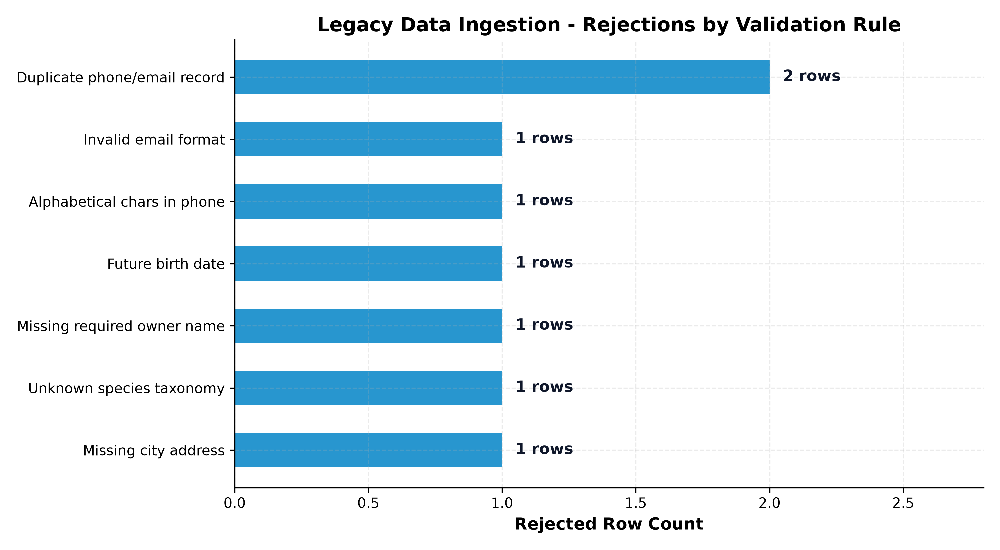

# VetTrack: Animal Health Records & Vaccination Monitoring Platform


> **VetTrack** is an enterprise-grade full-stack veterinary health platform engineered to automate patient registrations, prevent disease outbreaks through proactive vaccination recall schedules, and safeguard inventory stock integrity. Built specifically to demonstrate production competencies for the Zoetis Tech & Digital team (JR00021924), it unites a **Java 17 / Spring Boot 3** transactional backend with JWT security, a **React 18 / Vite** single-page web application, a **PostgreSQL 16** relational database with Flyway migrations, and a **Python data engineering service** for legacy CSV cleaning, validation, and Matplotlib analytics reporting.

*All data used in this repository is strictly synthetic and generated via scripts. No real personal or clinical data is ever stored.*

---

## 1. System Architecture



---

## 2. Analytics Visualizations (Generated by Python Data Service)

| Annual Administration Trend | Overdue Boosters by Species |
|---|---|
|  |  |

| Vaccine Batch Expiry Risk | Data Quality Rejection Audit |
|---|---|
|  |  |

---

## 3. Quick Start: Run Everything with One Command

You can boot the complete ecosystem (PostgreSQL, Spring Boot API, React Web Application, and Python Data Pipeline) with Docker Compose:

```bash
docker compose up --build
```

### Access URLs:
* **Frontend Web Application**: [http://localhost:5173](http://localhost:5173)
* **Backend REST API**: [http://localhost:8080/api/v1](http://localhost:8080/api/v1)
* **OpenAPI 3 / Swagger UI**: [http://localhost:8080/swagger-ui.html](http://localhost:8080/swagger-ui.html)
* **Actuator Health**: [http://localhost:8080/actuator/health](http://localhost:8080/actuator/health)

### Demo Credentials:
* **Administrator**: `admin` / `admin123` (Full administrative privileges, delete access, Actuator metrics)
* **Staff Member**: `staff` / `staff123` (Clinical operations, animal records, vaccination administration)

---

## 4. Running Locally Without Docker

### Prerequisites
* Java 17+ & Apache Maven 3.9+
* Node.js 20+ & npm
* Python 3.11+

### 1. Run Backend (Spring Boot):
The dev profile automatically runs an embedded H2 database in PostgreSQL compatibility mode with Flyway migrations:
```bash
cd backend
mvn spring-boot:run
```

### 2. Run Frontend (React):
```bash
cd frontend
npm install
npm run dev
```

### 3. Run Python Data Cleaning & Report Pipeline:
```bash
cd data-service
pip install -r requirements.txt

# Clean messy legacy CSV files
python -m src.clean --in raw/owners_legacy.csv --out cleaned/owners.csv --type owners
python -m src.clean --in raw/animals_legacy.csv --out cleaned/animals.csv --type animals

# Generate quality audit and Matplotlib charts
python -m src.quality_report
python -m src.make_charts
```

---

## 5. Automated Test Suite (40 Passing Tests)

The test suite covers domain business rules, REST API contracts, security authentication, data cleaning, and UI components:

```bash
# 1. Backend Unit & Integration Tests (20 tests: JUnit 5, Mockito, SpringBootTest)
cd backend
mvn clean test

# 2. Python Data Service Tests (15 tests: pytest)
cd data-service
pytest -v

# 3. Frontend Component & Integration Tests (5 tests: Vitest & React Testing Library)
cd frontend
npm test
```

---

## 6. Example API Usage (`curl`)

### 1. Authenticate and Obtain JWT:
```bash
curl -X POST http://localhost:8080/api/v1/auth/login \
  -H "Content-Type: application/json" \
  -d '{"username": "admin", "password": "admin123"}'
```
*Response:*
```json
{
  "token": "eyJhbGciOiJIUzI1NiJ9...",
  "tokenType": "Bearer",
  "username": "admin",
  "role": "ADMIN",
  "expiresInMs": 86400000
}
```

### 2. Record a Vaccination (Transactional Stock Decrement):
```bash
curl -X POST http://localhost:8080/api/v1/animals/1/vaccinations \
  -H "Authorization: Bearer <TOKEN>" \
  -H "Content-Type: application/json" \
  -d '{
    "vaccineId": 1,
    "batchId": 1,
    "givenOn": "2026-10-30"
  }'
```
*Business Rule Enforcement:*
* If the batch is expired (`expiryDate < givenOn`), returns `400 Bad Request` (`Batch Expired`).
* If batch stock is zero, returns `409 Conflict` (`Batch Out of Stock`).
* Automatically calculates `nextDueOn` from the vaccine booster interval.

---

## 7. Project Documentation Links

* [System Architecture & Design Document (ERD, Security, Decisions)](docs/design.md)
* [REST API Reference & OpenAPI Schema](docs/api.md)
* [SQL Notes & EXPLAIN ANALYZE Optimization Case Study](docs/sql-notes.md)
* [Sprint Retrospectives (Sprints 1, 2, 3)](docs/retro.md)

---

## 8. What I Would Improve Next

1. **Async Batch Ingestion**: Introduce Apache Kafka or Spring Cloud Stream for asynchronous event-driven processing of massive telemetry/livestock herd datasets.
2. **Automated SMS & Email Reminders**: Integrate Twilio / SendGrid background workers triggered by cron jobs for due booster alerts.
3. **Multi-Tenant Farm Support**: Extend database schemas with multi-tenant tenant isolation for commercial dairy cooperatives and farm chains.
