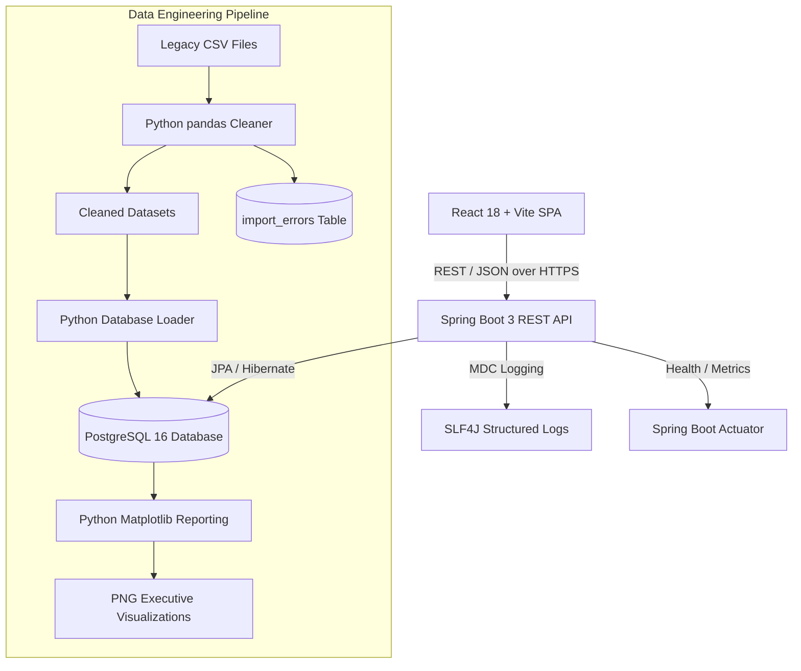
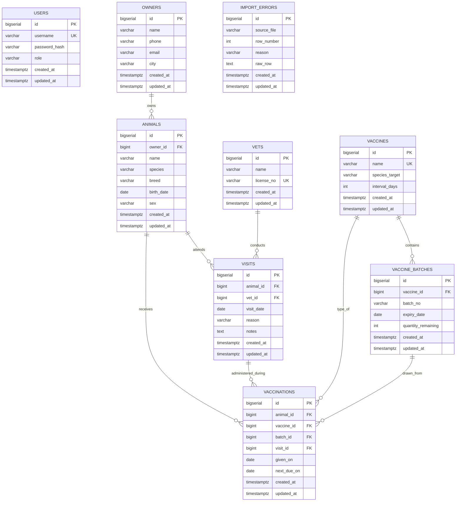

# VetTrack: System Design & Architecture Document

## 1. System Overview
VetTrack is an enterprise-grade veterinary health records, vaccination reminder, and stock management platform designed to automate clinical operations for small animal clinics and commercial livestock herds.

## 2. High-Level Architecture

## 3. Key Design Decisions

### Separation of Backend and Data Service
- **Java (Spring Boot 3)** handles the high-concurrency transactional REST API, enforces business domain constraints, manages JWT authentication and RBAC, and controls stock decrement within database transactions.
- **Python (pandas & Matplotlib)** handles analytical batch data pipelines, fuzzy cleaning of legacy client records, multi-format date normalization, and report generation.

### Transactional Vaccination & Stock Integrity
When a vaccination is recorded:
1. Animal existence and batch integrity are verified.
2. The batch's expiry date is compared with the administration date (`given_on`). If expired, a `BatchExpiredException` is thrown.
3. The remaining inventory is evaluated. If zero, a `BatchOutOfStockException` is thrown.
4. Stock is decremented within the same atomic `@Transactional` boundary.
5. The `next_due_on` booster date is automatically computed based on the vaccine's interval days.

### Security Architecture
- Stateless JWT authentication using HMAC-SHA-256 (`io.jsonwebtoken:jjwt`).
- Passwords hashed using standard `BCryptPasswordEncoder` (12 salt rounds).
- RBAC with two roles: `ADMIN` (can delete records and view Actuator metrics) and `STAFF` (can record clinic operations, clients, and vaccinations).

## 4. Entity-Relationship Diagram (ERD)

